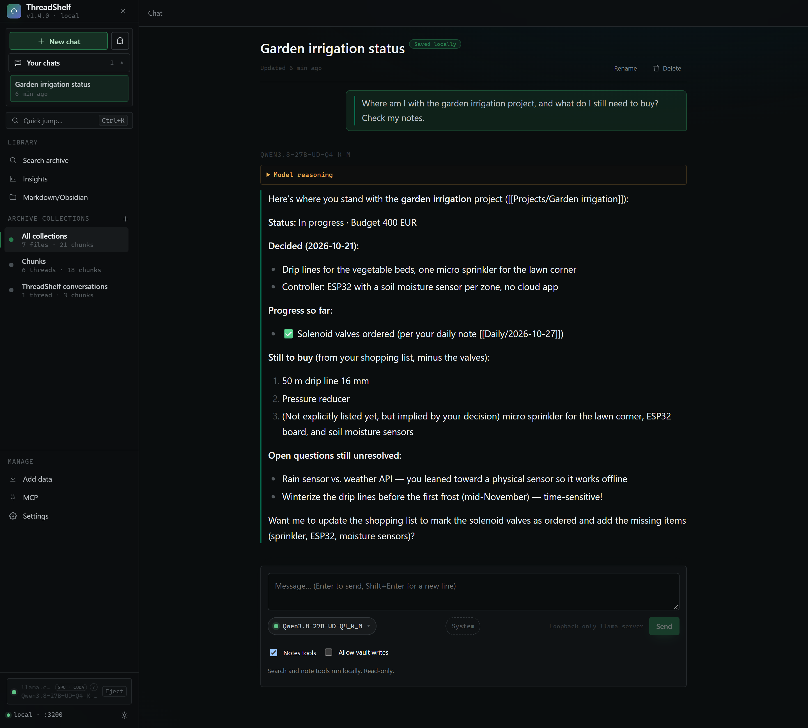
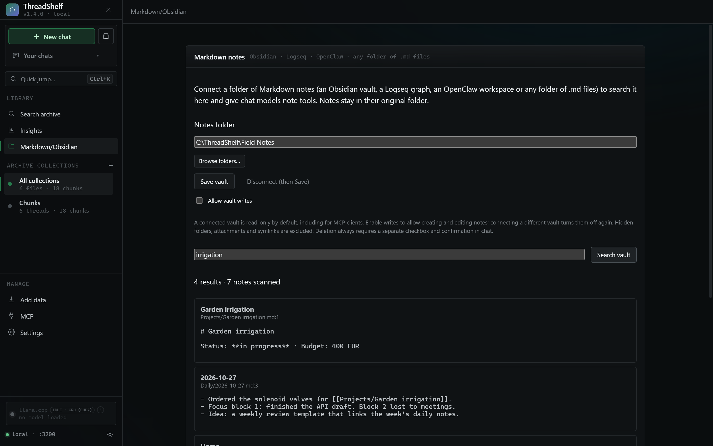

# ThreadShelf

A local app that archives your AI conversations and Markdown notes, searches them
by meaning and lets local models work with them. Nothing leaves your computer
unless you pick an external provider.

```sh
npx threadshelf
```

Requires Node.js 20.19 or newer. The app opens at `http://localhost:3000`.



## What it does

- **Chat archive.** Import exports from ChatGPT, Claude, Google AI Studio,
  OpenRouter, LM Studio and Grok. Search them by meaning, open the full thread
  and continue it.
- **Markdown and Obsidian.** Connect an Obsidian vault, a Logseq graph, an
  OpenClaw workspace or any folder of `.md` files. Local models can search,
  read and create notes; edits need your permission per vault.
  [Read more](OBSIDIAN.md).
- **Local models.** Chat with GGUF models through a managed `llama.cpp`,
  including image input. [Chat and local models](GENERATION.md).
- **MCP and API.** Claude Code, Codex and other MCP clients can search your
  archive and notes. The same models are served on an OpenAI- and
  Anthropic-compatible API. [MCP setup](MCP.md) · [Local model API](LOCAL_API.md).



## Start here

1. [Getting started](GETTING_STARTED.md): install, import your first export, search.
2. [Markdown and Obsidian](OBSIDIAN.md): connect your notes.
3. [FAQ](FAQ.md): privacy, data location, common problems.

## Official sources

ThreadShelf is only published here:

- GitHub: [github.com/ChrystianSchutz/ThreadShelf](https://github.com/ChrystianSchutz/ThreadShelf)
- npm: [threadshelf](https://www.npmjs.com/package/threadshelf)
- This site: [chrystianschutz.github.io/ThreadShelf](https://chrystianschutz.github.io/ThreadShelf/)

There is no installer, `.exe` or `.zip` download. If you find one, it is not
from this project; please report it.
